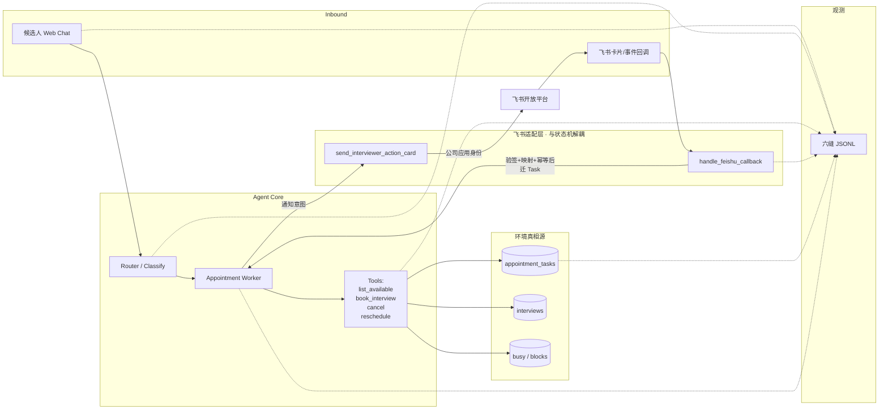

# 作品集 Agent 提升决策（单一事实源 · 按实现顺序）

> **本文件是所有提升决策的唯一落点。** 改仓库、写简历、排 PR、飞书接入与产品边界，以本文为准；六篇 Agent 笔记、Comma 调研、DSH SuperAgent 原型只提供依据，不另开决策分叉。
>
> **产品目标（已拍板）：** 一个 Agent 接管**全公司**面试预约与提醒——不是「候选人小助手」。
> - **候选人接入：** 网站对话入口（现有 content-agent 主路径）。
> - **面试官接入：** 飞书（**公司应用** MCP；应用身份发多人卡片/消息；`feishu_user_id` → `interviewer_id`）。**v1 必须接上真飞书租户可演示。**
> - **Web 面试官页：** 仅作兜底（无飞书客户端/深链失效），**非主路径**。
> - **稳定运行关键：** 持久 Task/日程真相源 + 幂等副作用 + book 后 verify + 可复现评测；**路由只是入口分流，不是全部。**
>
> 仓库：GitHub [`whickerpoplawski-arch/content-agent`](https://github.com/whickerpoplawski-arch/content-agent)（FastAPI / LangChain / FAISS / SQLite）。
> 目标岗位：主投 **Agent/Harness 工程师**、**Agent 开发工程师实习生**；OR/RL 工业岗仅走 Agent 架构支路且降预期。
> 本文件按 **Superpowers brainstorming（architectural）** 对齐后的实现顺序重写；**不把实现代码写进本决策文件，也不在本回合改 content-agent 仓库。**
>
> **读法（ambitious 深化后）：** §0–§2 定边界与顺序；§2.1–§2.3 定架构与「怎样证明不是口糊」；P1–P9 每节可直接开 PR（契约→迁移→失败幂等→验收断言→上下游）；附录 A/B 为跨阶段 schema 与飞书端口。

---

## 0. 全局约束（贯穿全部阶段）

| ID | 约束 |
|----|------|
| D0.1 | **不推倒重写**语言/框架；在现有 Python 栈上补工程合同与双边触达 |
| D0.2 | **保留**已有硬点：同事务 book、冲突回滚单测、LLM/天气降级 |
| D0.3 | **实现顺序**按本文 §P1→；禁止插队炫技（先飞书 UI、先换栈、先完整 Policy 引擎均禁止） |
| D0.4 | 简历**禁止**：精通 MCP/Harness、运筹/RL、虚高成功率%；「接了飞书 MCP」≠ 精通 MCP；MCP 依赖包 ≠ 能力 |
| D0.5 | **成功定义：环境终态（DB/日程）为准**，不以助手话术、飞书「已发送」、Session 结束为准 |
| D0.6 | Comma + DeepSeek SuperAgent 合同思维**必须吸收**（见文末摘要）；**禁止**接 DSH 运行时、换 TS、虚称精通 |
| D0.7 | **公司级真相源唯一：** `appointment_tasks` + interviews/busy；候选人 chat 与飞书回调都只挂 `task_id` / `interview_id` |
| D0.8 | **飞书身份模型：** MCP/连接器绑定的是**公司应用**，不是单个面试官账号；禁止一人 token 冒充全员 |
| D0.9 | **Prompt ≠ 授权：** 时段/冲突/过去时间/权限在工具层硬拒；飞书卡片动作必须验签/验映射后再写库 |
| D0.10 | 投递 ROI：**工程合同 P1–P5 可验证底座先于**飞书真连；但 **v1 交付定义含真飞书租户演示**（见 P7 Done） |

---

## 1. 短板认定（水在哪）— 已锁定

| ID | 短板 | 仓库/产品现象 | 提升要解决的合同 |
|----|------|---------------|------------------|
| G1 | Chat ≈ 系统 | 内存会话、`awaiting_confirmation`；重启丢半成品 | 持久 AppointmentTask |
| G2 | 多 Agent ≈ 路由标签 | CLASSIFY/INTERVIEW 枚举跳转，无业务终态断言 | Router/Worker + DB 完成条件 |
| G3 | 副作用无工具契约 | 预订埋 Processor；非显式 Tool Schema | 显式工具 + 幂等 + 层内校验 |
| G4 | 无可复现评测 | service 单测有，缺对话→DB Pass | evals + Pass@1 / Pass^k |
| G5 | 轨迹不可回放 | print 为主 | 六缝 JSONL（含飞书 inbound 后扩展） |
| G6 | 口糊成功 | 易宣称已预约而未 verify | book/确认后 verify 再标终态 |
| G7 | **仅候选人单向** | 面试官是被动资源；无待确认触达、无双边取消/改期通知 | 公司级状态机 + 面试官触达环 |
| G8 | **无可靠面试官通道** | 无飞书应用触达；管理页偏只读看板 | 飞书公司应用 MCP + 真租户演示 |

> G1–G6＝工程合同短板（投递主证据）；G7–G8＝公司级产品短板（v1 必须闭合到可演示）。

---

## 2. 实现顺序总表（已拍板 · 禁止插队）

| 序 | 阶段 | 关闭 | 一句话目标 |
|----|------|------|------------|
| **P1** | `evals/` 迷你评测 | G4 | 按 DB 终态可复现评测，先立尺子 |
| **P2** | AppointmentTask + 幂等 book | G1 G2 | 持久工单真相源；重启可续；幂等键 |
| **P3** | 显式 Tool + 六缝 JSONL | G3 G5 | 副作用经工具契约；轨迹可回放 |
| **P4** | book 后 verify | G6 | 话术不得早于环境终态校验 |
| **P5** | 确定性测试基建 | 工程可信 | clock / mock / 同 slot·同 idempotency 回归 |
| **P6** | 双边状态机扩展 | G7 | 待面试官确认/拒绝；双边取消·改期通知字段 |
| **P7** | 飞书适配层 + **真租户演示** | G8 | 公司应用发多人；卡片确认/拒绝回写；v1 必演示 |
| **P8** | 提醒环 | 公司级闭环 | 开场前催候选人+面试官（渠道可飞书优先） |
| **P9** | 面试官忙闲自报 | 资源侧完整 | 屏蔽/恢复；book 必须尊重 |

**并行规则：**
- P1 可与 P2 接口/文档设计并行；**P3 不得先于 P2 的幂等约定**；P4 依赖 P2 的 `task_id`。
- P6 可与 P5 尾部并行设计，但 **P7 不得在 P6 状态枚举未定前**接真卡片写库。
- **禁止**为赶飞书 Demo 跳过 P2/P4（口糊成功 + 无 Task＝公司级事故）。
- Web 面试官页：允许在 P7 后作**最小兜底**（同写库 API），不单独开大于飞书主路径的排期。

---

## 2.1 架构总览（Harness 视角 · 一页）

**一句话：** 两个 inbound（候选人 Web、飞书回调）汇入同一 Router/Worker；所有写副作用只经 Tools；唯一真相源是 `appointment_tasks` + `interviews` + `busy`；观测面是六缝 JSONL；飞书 SDK **只**活在适配层端口之后，状态机不直接调飞书。



**边界（开 PR 时对照）：**
- Router **不**持完整槽位、**不**直接 book；只分流到 Worker / 咨询等。
- Worker 读写 Task；book/cancel/reschedule **必须**走 Tool Schema（P3），经 service 写库，再经 verify（P4）才可对外宣称。
- 飞书适配层：入站 `handle_feishu_callback`、出站 `send_interviewer_action_card`；契约见 **附录 B**；状态枚举见 **§2.2**。
- Web 面试官页（若做）只调与卡片回调**同一写库路径**，禁止第二套状态机。

---

## 2.2 统一状态机（完整枚举 · 注明落地阶段）

> P2 落地初态骨架；P6 扩展双边与取消方；P4 决定何时可对外宣称 `booked`/`verified`。名称可微调，**语义与合法边不可擅自加减**（加减须先改本表）。

### 状态枚举

| 状态 | 落地 | 含义 |
|------|------|------|
| `collecting` | P2 | 收集候选人槽位/偏好 |
| `matching` | P2 | 匹配可用面试官/时段 |
| `awaiting_confirm` | P2 | 等待**候选人**确认推荐方案 |
| `awaiting_interviewer_confirm` | P6 | 等待**面试官**确认（卡片/兜底页） |
| `interviewer_rejected` | P6 | 面试官拒绝；槽应释放 |
| `booked` | P2+P4 | 环境终态已 verify；可对外宣称成功 |
| `confirmed` | P6 | 双边确认语义（实现可与 `booked` 合并或作别名；对外宣称仍以 verify 为准） |
| `failed` | P2 | 不可自动恢复的失败（含 verify 失败终态） |
| `cancelled` | P2+P6 | 已取消；须带 `cancel_actor` |
| `cancel_requested` | P6 | 取消请求已受理、副作用未完成 |
| `reschedule_pending` | P6 | 改期进行中 |
| `reschedule_failed` | P6 | 改期失败终态（可回到可再约） |
| `escalated` | P4 | 需人工/运营介入（可选字段级） |

辅助字段（非状态，但迁移依赖）：`task_id`、`client_request_id`、`interview_id`、`cancel_actor`∈{`candidate`,`interviewer`,`system`}、`notify_*` 意图、`verified_at`。

### 合法迁移（总表）

| From | To | 触发 | 阶段 |
|------|-----|------|------|
| `collecting` | `matching` | 槽位足够可匹配 | P2 |
| `matching` | `awaiting_confirm` | 产出推荐方案待候选人确认 | P2 |
| `matching` | `failed` | 无可用槽且不可恢复 | P2 |
| `awaiting_confirm` | `awaiting_interviewer_confirm` | 候选人确认后进入面试官确认（P6 路径） | P6 |
| `awaiting_confirm` | `booked` | 若产品允许「候选人确认即 book」的简化路径，**仍须 P4 verify** | P2+P4 |
| `awaiting_interviewer_confirm` | `booked` / `confirmed` | 面试官确认 + verify 通过 | P6+P4 |
| `awaiting_interviewer_confirm` | `interviewer_rejected` | 面试官拒绝 | P6 |
| `interviewer_rejected` | `matching` / `collecting` | 释放槽后允许再匹配 | P6 |
| `*`（非终态） | `cancel_requested` | 任一方发起取消 | P6 |
| `cancel_requested` | `cancelled` | 取消副作用完成 + 库一致 | P6 |
| `booked` / `confirmed` | `reschedule_pending` | 改期请求 | P6 |
| `reschedule_pending` | `booked` / `confirmed` | 改期成功 + verify | P6+P4 |
| `reschedule_pending` | `reschedule_failed` | 改期失败 | P6 |
| 任意写路径失败 | `failed` / `escalated` | verify 失败或不可恢复错误 | P4 |

### 非法边（必须拒绝 · 单测锁住）

| 非法 | 原因 |
|------|------|
| `booked` ← 无 verify | 冲突 D0.5 / G6 |
| `collecting` → `booked` 跳步 | 无匹配/确认合同 |
| 终态 `cancelled`/`failed` → `booked` 无新 `client_request_id` | 禁止复活旧幂等键 |
| 飞书回调直接改 `interviews` 绕过 Task 迁移 | 冲突 D0.7 / 适配层边界 |
| 面试官 A 确认映射到 B 的场次 | 权限模型 |

验收：迁移表有单元测试矩阵；非法边返回结构化错误且**不写** interviews。

---

## 2.3 Harness 级可验证性清单（投递岗 · 怎样证明不是口糊）

> 对应主投 Agent/Harness；映射 P1–P5/P7。面试时每条都能指向仓库路径或命令。

| # | 证明什么 | 怎么验 | 映射 |
|---|----------|--------|------|
| H1 | 成功看环境终态 | eval 断言查 `interviews`/`busy`，不看助手「已预约」字符串 | P1 P4 |
| H2 | 评测可复现 | `runs/<id>/` + `dataset_version` + sha256；Pass@1 / Pass^k 分相 | P1 |
| H3 | Chat ≠ 系统 | 杀进程后续聊同一 `task_id`；半成品在 `appointment_tasks` | P2 |
| H4 | 幂等 | 同 `client_request_id` 双调只一单（DB 行数断言） | P2 P5 |
| H5 | 副作用经工具契约 | grep/轨迹仅见 Tool Schema 调用，无 Processor 偷 book | P3 |
| H6 | 轨迹可回放 | 六缝 JSONL 按 `task_id` 拼出 inbound→…→reply | P3 附录 A |
| H7 | 不口糊 | verify 失败时回复含失败/升级语义且状态≠`booked` | P4 |
| H8 | 时间与外依赖可控 | 注入 clock；mock LLM；同 slot 回归红绿稳定 | P5 |
| H9 | 飞书是适配不是业务核 | 业务测试 mock 适配层；真租户脚本单独标签 | P7 附录 B |
| H10 | 回调安全 | 验签失败/错映射/重复 `event_id` 不迁状态 | P7 |

**简历禁令提醒：** 上表全绿前，不写「生产级 Harness / 精通 MCP」；有数才写 %（R8–R12）。

---

## P1 — `evals/` 迷你评测

**目标：** 立「环境终态」尺子；后续一切 PR 用同一套 DB outcome 说话。

**关闭短板：** G4（并为 P6–P8 预留用例槽，本阶段可不跑飞书 live）。

**约束细节：**
- 主指标：**DB outcome**（interviews + busy）；transcript 为辅（对齐 Anthropic Demystifying evals）。
- 报告 **Pass@1**；可靠性叙事优先 **Pass^k**。
- 起步 ≥20 条：正常订、冲突、推荐确认、缺槽澄清、拒订过去时间、幂等/同 slot。
- run 与 eval **分相**；`dataset_version` + 文件 sha256；畸形用例失败不伪装成可评负例。
- LLM-as-judge 仅软分；客观项不可缺。
- Capability vs Regression 分开维护。
- live / 真飞书用例默认跳过，标签隔离。

### 契约
- **输入：** `evals/datasets/<name>/cases.jsonl`（或等价）；每案含 `case_id`、`dataset_version`、对话/工具夹具、`expected_db`（interview/busy 断言）、标签（`capability`|`regression`|`live`）。
- **输出：** `evals/runs/<run_id>/`：`summary.json`（Pass@1、可选 Pass^k 区间）、每案 `trace` 指针、失败分类。
- **不变量：** 客观断言只读 DB/夹具，不把 LLM-as-judge 当硬门；`live` 默认不进 CI；畸形 case **fail-fast** 不计分。

### 状态迁移
- 本阶段**不改**业务状态机；断言消费 P2 起的状态字段。交叉引用 §2.2。

### 失败与幂等
- run 中途崩溃：允许重跑同一 `run_id` 策略须文档化（覆盖或新 id）；禁止静默丢失败案。
- 同一 case 重复跑用于 Pass^k，**不得**把 k 次里最好一次当唯一汇报。
- 外依赖失败：mock 路径必须可完成客观断言；live 失败标 `skipped`/`error` 分离。

### 验收断言（可操作 Done）
- [ ] `evals/` 目录存在且 README 写明一条命令可跑 mock 子集
- [ ] ≥20 条 case；至少含：正常订、冲突、缺槽、过去时间、同 slot/幂等
- [ ] 每案有 DB outcome 断言（可 grep `expected_db` 或等价键）→ 具体为 `interviews` + `interviewer_schedules` 增量断言
- [ ] run 前后未写仓库真实库 `data/interview_agent.db`（mtime / sha256 比对）
- [ ] evals 自身由 pytest 冒烟覆盖（runner 产物契约可机器检查）
- [ ] run/eval 分相：产物在 `runs/<id>/`；summary 含 Pass@1
- [ ] dataset 文件可计算 sha256 并写入 run 元数据
- [ ] `live`/`feishu` 标签默认跳过（CI 日志可证）
- [ ] Capability 与 Regression 分目录或分标签

### 与上下游接口
- **依赖：** 无强依赖；可与 P2 设计并行。早期 case 可用 service 级夹具，对话级在 P2/P3 后补全。
- **v1 真相源：** `interviews` + `interviewer_schedules(status=busy)`（+ `candidate_behaviors` 计数）；`appointment_tasks` 尚不存在，case schema 的 `task_id` 预留为 null，P2 落地后再断言 task 状态。
- **mock 口径：** 对话级 mock 是**脚本化确定性模型**（零外网）；mock 下 Pass^k 方差为零属构造使然，不得当可靠性区间叙事。
- **已实现行为缺口：** 过去时间拒订尚未实现（P3 工具层硬拒）；P1 记为 `pending:p3` 用例，不计入 Pass@1 分母。
- **预留：** case schema 预留 `task_id`、飞书 `source` 字段（P6–P8 增补双边/拒绝/提醒时不改主格式）。

**Done：**
- ≥20 用例可跑；DB 断言；产出 `runs/<id>/`；文档写清如何跑。

**简历可写：** 「自建预约评测：run/eval 分离，按 DB 终态，Pass@1（及 Pass^k）」。  
**不可写：** 虚高通过率%；「生产级 Evalens」；未跑通的飞书 E2E 当已绿。

---

## P2 — AppointmentTask + 幂等 book

**目标：** Ticket ≠ Chat；全公司一份工单真相源，chat/飞书只挂引用。

**关闭短板：** G1、G2（状态机骨架；双边态在 P6 扩展）。

**约束细节：**
- 表 `appointment_tasks`（或等价）；chat 只挂 `task_id`。
- 初版状态至少：`collecting` → `matching` → `awaiting_confirm`（候选人确认推荐）→ `booked` / `failed` / `cancelled`。
- API/内部区分 **accepted / committed / verified**；完成＝verify 通过（P4 落地 verified）。
- `client_request_id` 唯一；意图落库后再 book；打断/重启不盲重 book（先查库再决）。
- 压缩上下文：**先压 chat，不压 Task JSON**。
- 分类 Agent ≈ Router；预约 ≈ Worker；分类不持完整槽位。
- 对话结束 ≠ Task completed。

### 契约
- **表要点 `appointment_tasks`：** `task_id` PK；`client_request_id` UNIQUE；`status`；`candidate_ref`；槽位 JSON；`interview_id` 可空；`created_at`/`updated_at`；可选 `accepted_at`/`committed_at`/`verified_at`。
- **API/内部：** `create_or_get_task(client_request_id)` → 同键返回同行；`transition(task_id, to_status, reason)` 只允许 §2.2 中 **P2 列**边。
- **不变量：** chat session 只存 `task_id`；Router 不持久化完整槽位；无 verify 不得把对外成功比特打开（P4 前 `booked` 仅内部/测试慎用，对外话术仍诚实）。

### 状态迁移（P2 子集 · 完整见 §2.2）

| From | To | 合法 |
|------|-----|------|
| `collecting` | `matching` | ✓ |
| `matching` | `awaiting_confirm` | ✓ |
| `matching` | `failed` | ✓ |
| `awaiting_confirm` | `booked` | ✓（对外宣称仍等 P4） |
| `*` | `cancelled` / `failed` | ✓（P2 简化取消可一步到位） |
| `booked` | `collecting` | ✗ |
| `collecting` | `booked` | ✗ |

### 失败与幂等
- **幂等键：** `client_request_id`（全局唯一）；重复 book 意图 → 返回已有 `task_id`/`interview_id`，不插第二行。
- **失败：** 冲突回滚保持现有同事务语义（D0.2）；迁移非法 → 结构化错误，状态不变。
- **禁止口糊：** 进程重启后禁止「假设上次已 book」；必须先读 Task/interview。

### 验收断言
- [ ] 迁移或 repo 层存在 `appointment_tasks`（名称等价可）
- [ ] UNIQUE(`client_request_id`) 有测试：双调只一单
- [ ] 重启/新 session 挂同一 `task_id` 可续（单测）
- [ ] 非法迁移单测期望拒绝
- [ ] 文档写明 accepted/committed/verified 三阶段语义（verified 实现可标 TODO→P4）

### 与上下游接口
- **依赖：** P1 尺子可先用 service 断言；本阶段为 P1 对话级 case 提供 `task_id`。
- **预留：** 状态枚举预留 P6 名（可先不出现在迁移实现）；通知字段可空列。

**Done：**
- 表+repo；状态机读写；重启可续聊单测；同 `client_request_id` 双调只一单。

**简历可写：** 「预约从内存会话升级为持久 Task；副作用带幂等键」。  
**不可写：** 「多 Agent 编排平台」；「已接管全公司生产日程」（P7 真租户演示前）。

---

## P3 — 显式 Tool + 六缝 JSONL

**目标：** 副作用经工具契约；轨迹可回放（含后续飞书 inbound 扩展位）。

**关闭短板：** G3、G5。

**约束细节：**
- 必做四工具：`list_available` / `book_interview` / `cancel` / `reschedule`（Pydantic/JSON Schema + edge + 相似工具边界）。
- **工具即接口：** 清晰命名 + 参数 schema + **给模型看的短错误文案**（可复现纠正）；禁止把整段巨型 JSON/堆栈原样塞回模型（对齐 Anthropic *Writing effective tools for agents* 口径）。
- `book_*` **强制** `client_request_id`。
- 三类副作用：意图落库 → 调用 service → verify（verify 在 P4 闭合）。
- 统一 `ToolEvent`；天气工具也走同一缝。
- 六缝 JSONL：`inbound` / `classify` / `tool_call` / `tool_result` / `db_commit` / `reply`；P7 起 `inbound` 可来自飞书回调，语义不变。
- role prompt ≠ 工具授权；时段/面试官/过去时间工具层硬拒。
- **循环必须可停：** 单任务设最大步数 / 有界重试；禁止无限「再试」烧钱（成本上限可后置记录，但步数硬顶 v1 必有）。

### 契约
- **工具输入/输出（要点）：**
  - `list_available`：时段窗、可选面试官 → 可用 slot 列表；硬拒过去时间。
  - `book_interview`：**必填** `client_request_id` + slot/面试官 → `task_id`/`interview_id`/状态；冲突短错误。
  - `cancel` / `reschedule`：挂 `task_id` 或 `interview_id` + 幂等键；权限在层内校验。
- **六缝事件：** 见 **附录 A**（本阶段必须落盘可 grep）。
- **不变量：** Processor 不得绕过 Tool 写 interviews；短错误面向模型；步数硬顶。

### 状态迁移
- 工具触发的迁移必须落在 §2.2 合法边；交叉引用 P2。本阶段不扩展双边态。

### 失败与幂等
- `book_interview` 无 `client_request_id` → schema 校验失败，不调用 service。
- 工具超时/抛错 → `tool_result` 记失败；有界重试；超过步数 → 停并标失败/升级，不口糊成功。
- 天气等只读工具失败 → 降级模板（保留 D0.2），仍写缝。

### 验收断言
- [ ] 四工具均有 JSON Schema/Pydantic；`book_*` 字段强制幂等键
- [ ] 至少 1 条完整六缝示例轨迹入库（可 `grep '"seam":' ` 或等价）
- [ ] 关键路径回放脚本或文档：按 `task_id` 拼出顺序
- [ ] 存在最大步数配置且单测/夹具能触发熔断
- [ ] 过去时间/冲突由工具层返回短错误（单测）

### 与上下游接口
- **依赖：** P2 幂等约定与 `task_id`（**不得**先于 P2 幂等）。
- **预留：** `inbound.source` 枚举含 `web`|`feishu`（P7）；`db_commit` 后接 P4 verify 事件可同缝或子类型。

**Done：**
- 四工具 schema；示例轨迹入库；关键路径可 grep 回放。

**简历可写：** 「副作用经显式工具接口；inbound→tool→DB→reply 可回放」。  
**不可写：** 「精通 MCP」；把天气 Tool 包装成 MCP 平台。

---

## P4 — book 后 verify

**目标：** Accepted ≠ completed；禁止口糊成功。

**关闭短板：** G6。

**约束细节：**
- `verify_booking`（或等价）：核对 interview 行与 busy schedule 一致才标 `booked`/`verified`。
- 失败 → `failed`/`escalated` 可判定字段；话术不得早于校验。
- 可选一次有界重试；禁止无限模型自循环「再试」。
- 结构化诚实 Report（对齐 DSH S-A6）。

### 契约
- **输入：** `task_id` / `interview_id`（刚 committed）。
- **输出：** `verified`（写 `verified_at`，状态允许对外 `booked`）或 `failed`/`escalated` + 原因码。
- **不变量：** 助手「成功」话术 **仅**在 verify 通过后；飞书「已点确认」同样要再 verify（P7）。

### 状态迁移
- `awaiting_*` / committed 中途 → `booked` 当且仅当 verify OK；否则 → `failed`/`escalated`。见 §2.2。

### 失败与幂等
- verify 重复调用：已 `verified_at` 则幂等返回成功，不改历史。
- 一次有界重试后仍不一致 → 终态失败，禁止模型死循环。
- **禁止口糊：** 任何「已预约」字符串出现在 verify 前的 reply 缝 → 评测负例应红。

### 验收断言
- [ ] 主路径调用 `verify_booking`（或等价）可在代码路径上定位
- [ ] 负例 eval：制造 interview/busy 不一致 → 不得标 booked、话术非成功
- [ ] 正例：一致则 `verified_at` 非空
- [ ] Report 结构化字段（status/reason）可断言

### 与上下游接口
- **依赖：** P2 `task_id`；建议 P3 工具链已接通。
- **预留：** P6 面试官确认后同样走 verify；P7 回调成功 ≠ verify 豁免。

**Done：**
- verify 接入主路径；失败不宣称成功；至少一条负例 eval 锁住。

**简历可写：** 「落库后校验记录与忙碌日程一致才标 booked」。  
**不可写：** 「保证 100% 预约成功」。

---

## P5 — 确定性测试基建

**目标：** 关键路径时间与外依赖可控；公司级回归可红可绿。

**关闭短板：** 工程可信（支撑 G1–G6 不回潮）。

**约束细节：**
- 可注入 clock；mock LLM/天气（及后续 mock 飞书适配层）。
- 同 idempotency / 同 slot 回归；live 默认跳过。
- 金丝雀：订一条→查库→取消；CI 默认可 mock-LLM 子集。

### 契约
- **输入：** 测试夹具（固定 clock、mock completion、可选 mock FeishuPort）。
- **输出：** CI 或一键脚本的红绿；金丝雀报告。
- **不变量：** 默认 CI 零真网；live 显式打开。

### 状态迁移
- 不新增业务态；回归覆盖 §2.2 中 P2/P4 边与非法边子集。

### 失败与幂等
- 同 `client_request_id` / 同 slot 夹具必须稳定绿；时钟漂移不得导致偶发红（注入 clock）。
- mock 飞书端口失败注入 → 业务态符合 P6/P7 预期（接口可先空实现）。

### 验收断言
- [ ] clock 可注入（单测改时间不影响主机）
- [ ] mock LLM 路径文档化并进 CI 或 `make test-canary`
- [ ] 金丝雀：订→查库→取消三条断言
- [ ] 同 idempotency 回归存在
- [ ] live 标记默认 skip

### 与上下游接口
- **依赖：** P2–P4 主路径可测。
- **预留：** `FeishuPort` mock 供 P7；P6 用例槽接入 P1 dataset。

**Done：**
- clock 注入落地；上述回归进 CI 或文档化一键脚本。

**简历可写：** 「关键路径单测可控时间与外依赖」。  
**不可写：** 「形式化验证 / TLA+ / Lean」（刻意不做）。

---

## P6 — 双边状态机扩展（公司级产品环）

**目标：** 从「候选人单向确认」扩展到「面试官必须处理的待办」；仍不接飞书，先定枚举与通知字段。

**关闭短板：** G7。

**约束细节：**
- 扩展状态（名称可微调，语义固定），至少含：
  - `awaiting_interviewer_confirm`（候选人侧已选定/已 book 意图后）
  - `interviewer_rejected` → 释放槽 → 候选人可再匹配
  - `confirmed` / `booked`（与 P2/P4 对齐：仅 verify 后可对外宣称）
  - `cancel_requested` / `cancelled`（记录 **取消方**：candidate | interviewer | system）
  - `reschedule_pending` / 改期成功或失败终态
- **通知意图字段**（可先落库不发送）：`notify_candidate` / `notify_interviewer`、原因码、幂等 `notification_id`。
- 权限模型草稿：面试官动作只能作用于映射到自己的 `interviewer_id` 的场次。
- 评测：增补「拒一面→槽释放→再约」等 DB outcome 用例（仍 mock 通道）。
- **本阶段不做**真飞书发送；通道适配留 P7。

### 契约
- **扩展字段：** `cancel_actor`；`notification_id` UNIQUE；`notify_candidate`/`notify_interviewer` bool+reason；可选 `pending_interviewer_id`。
- **动作 API（内部）：** `request_interviewer_confirm(task_id)`；`apply_interviewer_decision(task_id, interviewer_id, accept|reject)`；`request_cancel` / `request_reschedule`——**不**在此调飞书 SDK。
- **不变量：** 通知意图可落库而 `sent_at` 为空；发送属 P7/P8。

### 状态迁移（P6 扩展 · 与 §2.2 一致）

| From | To | 触发 |
|------|-----|------|
| `awaiting_confirm` | `awaiting_interviewer_confirm` | 候选人确认 |
| `awaiting_interviewer_confirm` | `booked`/`confirmed` | 面试官接受 + verify |
| `awaiting_interviewer_confirm` | `interviewer_rejected` | 面试官拒绝 |
| `interviewer_rejected` | `matching`/`collecting` | 槽释放 |
| 非终态 | `cancel_requested` → `cancelled` | 取消方记录 |
| `booked`/`confirmed` | `reschedule_pending` → 成功/失败 | 改期 |

**非法：** 无映射面试官写入接受；拒绝后不释放 busy；跳过 `cancel_requested` 直接抹行无审计字段。

### 失败与幂等
- `notification_id` 幂等：同一通知意图不重复插。
- `apply_interviewer_decision` 重复同决策 → 幂等成功；冲突决策 → 结构化拒绝。
- 权限失败不迁状态、不发通知意图。

### 验收断言
- [ ] §2.2 扩展态出现在代码枚举与迁移表文档
- [ ] 迁移矩阵单测含拒绝→释放→再匹配
- [ ] `cancel_actor` 可读写并有断言
- [ ] 通知意图可落库；本阶段无真发送
- [ ] P1 dataset 增补至少 1 条双边 DB outcome（mock）

### 与上下游接口
- **依赖：** P2 骨架；可与 P5 尾部并行设计。
- **预留：** 决策函数签名供 P7 回调直接调用；禁止 P7 另写一套迁移。

**Done：**
- 状态枚举与迁移表文档化+单测；取消方/拒绝/改期字段可读写；通知意图可落库。

**简历可写：** 「预约工单支持待面试官确认/拒绝与双边取消改期状态」。  
**不可写：** 「已对接飞书全员」（P7 前）；「HR/Offer 工作流」。

---

## P7 — 飞书适配层 + 真租户演示（v1 必达）

**目标：** 面试官主路径＝飞书；公司应用身份触达多人；卡片确认/拒绝回写 DB。

**关闭短板：** G8。

**约束细节：**
- **MCP/连接器绑定公司飞书应用**（机器人/应用身份），按 `feishu_user_id` → `interviewer_id` 映射表路由到人。
- 适配层接口与 Processor 解耦：`send_interviewer_action_card` / `handle_feishu_callback`；**禁止**业务状态机直接散落调 SDK。
- 卡片动作：确认 / 拒绝（及可选改期入口）；回调验签 + 身份映射 + 幂等（同 event_id 只处理一次）后再迁状态。
- **v1 必须**在**真飞书租户**可演示：至少「新约 → 面试官收卡 → 确认或拒绝 → DB 终态变化 →（拒绝则）候选人侧可感知」。
- Web 面试官页：可选最小页调同一写库 API，**非主路径、不阻塞 P7 Done**。
- 六缝：`inbound` 来自飞书时写清 source=`feishu`。
- 简历口径：做完后写「飞书**应用触达** + 工具/回调契约」；**不写精通 MCP/Harness**。
- 密钥/租户配置走环境与 vault 习惯；决策文件与仓库**不写密钥**。

### 契约
- 详见 **附录 B**（端口签名、验签、映射、幂等）。摘要：
  - 出站：`send_interviewer_action_card(task_id, interviewer_id, actions)` → 渠道消息 id；先有通知意图行。
  - 入站：`handle_feishu_callback(raw)` → 验签 → 映射 → `event_id` 去重 → 调用 P6 `apply_interviewer_decision` → 再 P4 verify（若接受）。
- **不变量：** 状态机零 SDK import；一人 user token 禁止（D0.8）。

### 状态迁移
- 回调只触发 §2.2 已定义边；不新增「飞书专用状态」。

### 失败与幂等
- 验签失败 / 未知 `feishu_user_id` / 重复 `event_id` → 不写库（可记审计）。
- 发送失败：通知意图 `sent_at` 为空可有界重试；**不**因「API 接受」将 Task 标 booked。
- 卡片「确认」仍须 verify（P4）。

### 验收断言
- [ ] 适配层模块边界清晰（目录或接口名可 grep）
- [ ] 回调夹具：验签失败、错映射、重复 event_id 三负例
- [ ] 确认路径与拒绝路径各至少一条 DB 断言（可 mock 适配 + 真租户脚本分离）
- [ ] 真租户演示步骤文档/录屏要点；密钥不在仓库
- [ ] 六缝 inbound `source=feishu` 示例一行
- [ ] Web 兜底若存在：与回调共写库函数

### 与上下游接口
- **依赖：** P6 枚举与 `apply_interviewer_decision` **必须先定**。
- **预留：** P8 复用同一出站端口发提醒；P9 复用应用发忙碌登记入口。

**Done：**
- 真租户演示脚本/录屏要点可复现；确认与拒绝两条路径 DB 断言绿；映射与幂等单测（回调可用夹具）。

**简历可写：** 「面试官经飞书公司应用卡片确认/拒绝；回调经幂等写入预约终态」。  
**不可写：** 「精通 MCP」；「飞书官方 Harness」；「一人 Bot 冒充全员已合规完备」（只写已做的应用身份+映射）。

---

## P8 — 提醒环

**目标：** 开场前主动催双边；Agent「自己处理业务再沟通待办」的时间维闭合。

**关闭短板：** 公司级闭环（提醒）。

**约束细节：**
- 调度：cron/队列即可（叙事对齐「少占人注意力」）；**不**上 24/7 自进化 Loop。
- 提醒对象：候选人 + 面试官；渠道优先飞书（面试官）、网站/邮件可作候选人补充。
- 提醒也是副作用：意图落库 → 发送 → 记录结果；失败可重试有界，不口糊「已提醒」。
- 评测：到点应提醒的 fixture（注入 clock）。

### 契约
- **输入：** 调度触发 + `interview_id`/`task_id` + 开场时间（clock）。
- **输出：** 通知意图行 + 渠道结果（成功/失败码）；六缝可记 `tool_call` 或专用 notify 子类型。
- **不变量：** 「已提醒」以渠道结果落库为准；cron 非自进化（X4）。

### 状态迁移
- 一般**不改**预约主状态；可写提醒审计字段。若产品要将「未确认超时」升级，须先改 §2.2 再实现。

### 失败与幂等
- 幂等键：`notification_id` 或 `(interview_id, remind_offset)` UNIQUE。
- 发送失败有界重试；禁止无限刷屏（S-A9）。

### 验收断言
- [ ] 注入 clock 的「到点应提醒」fixture 绿
- [ ] 双端意图可查；面试官路径优先真飞书或可切换策略文档化
- [ ] 失败不写成功话术/成功比特

### 与上下游接口
- **依赖：** P7 出站端口（或 mock）；P5 clock。
- **预留：** 提醒模板不影响 P9 忙闲。

**Done：**
- 至少一条「开场前双端提醒」路径可演示（真飞书或 mock+真租户策略在实现时二选一，**优先真飞书面试官提醒**）。

**简历可写：** 「预约前提醒候选人与面试官，发送结果落库可查」。  
**不可写：** 「智能 HR 助手覆盖入职全流程」。

---

## P9 — 面试官忙闲自报

**目标：** 资源侧可自助屏蔽/恢复；book 强制尊重。

**关闭短板：** 资源完整性（减少人工改库）。

**约束细节：**
- 面试官经飞书（主）或 Web 兜底申报不可用时段；写入 busy/block 表。
- `list_available` / `book_*` **必须**读屏蔽；工具层硬拒冲突。
- 不与 P7 抢主路径；可在真租户上复用同一应用发「忙碌登记」入口。

### 契约
- **输入：** `interviewer_id` + 时段 + 动作 `block|unblock`（来源 feishu/web）。
- **输出：** busy/block 行；`list_available` 不再返回该槽；`book_*` 冲突短错误。
- **不变量：** 工具层强制读屏蔽；禁止仅 prompt「请避开」。

### 状态迁移
- 不新增预约主状态；资源表独立。非法：对他人 `interviewer_id` 写屏蔽。

### 失败与幂等
- 同一屏蔽时段重复申报幂等；解除后可再约。
- 申报失败不假装已屏蔽（D0.5）。

### 验收断言
- [ ] 自报忙闲 → `list_available` 不可见
- [ ] `book_*` 硬拒有单测/eval
- [ ] 权限：非本人映射拒绝
- [ ] 三条断言或 eval 文档化

### 与上下游接口
- **依赖：** P3 工具；P7 应用身份可选复用。
- **预留：** 无（v1 边界止于此；不做运筹 X 与 Offer X8）。

**Done：**
- 自报忙闲 → 列表不可约 → book 硬拒，三条断言或 eval。

**简历可写：** 「面试官可自报忙闲，预约工具层强制避让」。  
**不可写：** 「自动排班优化 / 运筹求解」。

---

## 3. 架构 / 工具 / 评测选型摘要（已拍板 · 不另开分叉）

### 架构
| ID | 决策 |
|----|------|
| A1 | 主路径 **Routing + 持久状态机**，不用开放 ReAct 乱逛 |
| A2 | 分类 ≈ Router；预约 ≈ Worker；飞书回调 ≈ 另一 inbound 入口进同一 Worker/状态机 |
| A3 | 对话/卡片交互结束 ≠ Task completed |
| A4 | 先压 chat，不压 Task JSON；上下文工程按 Write/Select/Compress/Isolate 口径，**能说清每步进模型的内容**优先于框架名 |
| A5 | 偏好可温层；半成品预约必须持久 Task |
| A6 | role prompt ≠ 工具授权；飞书回调 ≠ 自动授全权（须映射+验签+幂等） |
| A7 | **框架 checkpoint ≠ 持久执行：** LangChain/会话检查点不能替代 `appointment_tasks`；进程挂了任务须可从工单续，不从聊天第 1 步重来（v1 不强制 Temporal/Inngest，但禁止把「有 checkpoint」写成耐久执行） |
| A8 | **人工介入不空转：** 等面试官确认时挂起 Task（不占循环烧 token）；卡片/回调再唤醒。防审批疲劳：只对写副作用与确认态弹人，不问句句审 |
| A9 | **权限最小集：** 工具面尽量小；飞书 inbound 当不可信内容处理（防注入驱动乱 book）；危险写操作必须经工具层+状态机，不经自由文本「同意」 |

### 工具
| ID | 决策 |
|----|------|
| T1 | 四工具：`list_available` / `book_interview` / `cancel` / `reschedule` |
| T2 | `book_*` 强制 `client_request_id` |
| T3 | 意图落库 → service → verify；失败不撒谎 |
| T4 | **飞书**走「公司应用触达适配层」；对外可称 MCP/连接器接入，简历不写精通 MCP |
| T5 | 统一 ToolEvent / 六缝；天气与飞书发送均占缝 |
| T6 | 只读 MCP 再暴露查询：**仅** T1–T3 与 P7 触达稳定后考虑；非 v1 必达 |

### 评测
| ID | 决策 |
|----|------|
| E1 | 主指标 DB outcome（最终结果层） |
| E2 | Pass@1 + 叙事 Pass^k（重复跑给区间，不报单次最好成绩） |
| E3 | ≥20 条起步；P6+ 增补双边/拒绝/提醒用例 |
| E4 | run/eval 分相；dataset 版本与哈希 |
| E5 | LLM-as-judge 仅软分 |
| E6 | 金丝雀：订→查库→取消；（P7）另加「卡确认→查库」 |
| E7 | Capability 与 Regression 分开 |
| E8 | **三层评测意识：** 最终结果 / 轨迹（工具顺序是否合理，可部分分） / 单步（排障）；v1 必保最终结果+可回放轨迹，单步评分可后置 |
| E9 | 可记录指标（有数才写简历）：成功率区间、平均步数、单任务成本、工具失败率、人工介入率、超预算终止率；**无数不写 %** |
| E10 | 公开榜（τ²-bench 等）仅作认知；作品集主证据是**自建预约 eval**；脚手架差异可显著改分，叙事强调工程变量 |

---

## 4. 简历 / 投递表述（已拍板）

| ID | 决策 |
|----|------|
| R1 | 对外项目名演进：**「全公司面试预约与提醒 Agent」**（实现未到 P7 前对内可仍称待面试预约 Agent，投递材料与仓库 README 在 P7 Done 后统一改口） |
| R2 | 主打随阶段升格：先多 Agent 路由/事务/降级/RAG → P1–P5 后升格评测与 Tool → P7 后升格「飞书应用触达+回调契约」 |
| R3 | **禁止**：运筹/RL/自进化、精通 MCP/Harness、无证据 %、基于/精通 DSH SuperAgent |
| R4 | Ownership：未确认前不写「主导团队」；默认个人项目/负责实现 |
| R5 | Harness 开场白：P1–P3 前承认 Tool/评测在补；P7 前承认面试官触达在补 |
| R6 | 旧内容流水线＝历史资产，不与当前作品集证据混报 |
| R7 | 飞书相关**仅可**写清：公司应用身份、user 映射、卡片确认/拒绝回写、与 DB 终态一致——做完再写 |
| R8 | **写结论不写工具堆砌：** 「测到/发现/取舍」＞「用了 LangChain/飞书 MCP」。弱句示例禁止：「基于 LangGraph 的多智能体」；强句模板：「工具失败率从 X→Y（集规模/跑次可答辩）」「崩溃后从 Task 第 N 步续跑」「写操作挂起等人确认，人工介入率 Z%」「Pass@1 区间 A–B（k 次）/单任务成本 $Y」——**无数则删数字，留机制** |
| R9 | **禁止「熟悉/了解 XXX」空话**；改写成具体编排与恢复行为（如「持久 Task + 幂等 book + DB verify」） |
| R10 | **数字必须可答辩：** 集多大、跑几遍、失败 15% 是什么原因、成本怎么算；答不出的 % 是负资产 |
| R11 | **少堆框架名，多写取舍：** 例如为何 Routing+状态机而非开放多 Agent 乱逛；多 Agent 成本高收益不明则如实写选择（对齐指南：瞎写「多智能体协同」反扣分） |
| R12 | **按阶段包装、切勿眼高手低：** 未完成 P1–P5/P7 不把简历写成「生产级全套 eval+企业权限+真用户」；面试够用阶段性证据，吹过吹穿更伤 |

---


### 简历项目包装参考（对齐指南 · 非虚构成绩）

对外标题可演进为：**全公司面试预约与提醒 Agent｜持久工单 · 工具契约 · 轨迹评测 · 飞书确认**（仅在对应 P 完成后再挂副标题词）。

条目优先顺序：工具 schema/短错误与失败率机制 → Task 断点续跑 → 写操作/面试官确认挂起与介入率 → 三层评测意识与 Pass 区间（有数才写）→ 架构取舍（单路由状态机 vs 堆多 Agent）。


## 5. 刻意不做（禁止开工）

| ID | 不做 | 原因 |
|----|------|------|
| X1 | Elixir/OTP / TypeScript 重写；接入 DSH·Harness 运行时 | 成本与岗位信号不匹配 |
| X2 | Lean / TLA+ | 不证明模型判断；简历易翻车 |
| X3 | 完整 IFC / 真 MCP 集群 / 完整 Policy·Admission 规则引擎 | 过重；工具层硬校验 + 飞书适配层即可 |
| X4 | 24/7 Loop / Spinfoam / 自进化 | cron 提醒叙事足够 |
| X5 | 天气 Tool 或「接了飞书」包装成精通 MCP；教 Sampling 当卖点 | 事实与规范不符 |
| X6 | GitHub Source 工单扇出、Superagent Panel 监督台 | 场景/ROI 不符 |
| X7 | 以 PR merge / Session 结束 / 「消息已发送」为成功定义 | 冲突 D0.5 |
| X8 | **Offer / 薪资 / 评价录入 / 录用管线** | 可永不做；非预约提醒边界 |
| X9 | 面试官主路径改回「每人长对话 Agent」或「仅 Web 后台无推送」 | 已拍板飞书主路径+Web 兜底 |
| X10 | 一人用户 token 冒充全公司面试官 | 冲突 D0.8 |

---

## 6. Comma + DSH 必吸收摘要（强制 · 不改实现顺序）

> Comma：[AFK-surf/Comma](https://github.com/AFK-surf/Comma)。  
> DSH：[deepseek-ai/dsh-superagent-prototype](https://github.com/deepseek-ai/dsh-superagent-prototype)（研究原型；成功终态在本项目仍是 **DB 日程**，不是 PR merge）。

| ID | 思维 | 落点 |
|----|------|------|
| C1 / S-A1 | Task/Ticket ≠ Chat | P2；全入口挂 task_id |
| C2 / S-A2 | Accepted ≠ completed | P4；飞书「已点确认」仍要 verify |
| C3 / S-A8 | Fence / 幂等 / 先落库再副作用 | P2、P5、P7 event_id |
| C4 | 迷你评测语义 | P1 |
| C5 / S-A10 | 六缝可回放 | P3（+P7 source=feishu） |
| C6 | 确定性测试 | P5 |
| S-A3 / A6 | Gate 在工具层 | P3、P9 |
| S-A4 | Observe 再 Auto | 评测干跑 / 拟 book |
| S-A5 | Router≠Worker | A2；飞书回调不进分类闲聊 |
| S-A6 | 结构化诚实 Report | P4、P6 枚举 |
| S-A7 | Prompt ≠ 授权 | D0.4、D0.9 |
| S-A9 | 注意力经济 | 卡片短、确认一次一问；少刷屏 |

**DSH 刻意不吸收：** S-X1–S-X6（TS/DSH 运行时、完整 Policy、GitHub/飞书 Source 扇出复刻、Panel、错误成功定义、简历虚称）——注：本项目 **P7 自建飞书应用触达** ≠ 复刻 DSH 的 Feishu Source 子系统。

**面试口径（不虚称做过 DSH）：**  
对照过公开超级 Agent 原型里 Ticket/授权与执行分离、以及「受理 ≠ 环境终态已校验」；本 Agent 落在自建持久 Task、工具硬校验、按 DB 终态的 eval，以及飞书**公司应用**卡片回写，而不是复刻其 Harness 运行时。

---

## 7. 信息源迭代约束

| ID | 约束 |
|----|------|
| S1 | 评测对齐 Anthropic [Demystifying evals](https://www.anthropic.com/engineering/demystifying-evals-for-ai-agents) |
| S2 | 不引入 Mem0 四类记忆背诵；只落实 Task 持久 + 偏好温层 |
| S3 | MCP 规范认知可更新，但交付以本仓库工具契约 + 飞书适配为准；勿把 Sampling 当卖点 |
| S4 | 六篇笔记源迭代见 [[memory-source-delta-2026-11]]；**排期只认本文 §2** |
| S5 | 飞书：以官方开放平台「应用身份 / 事件订阅 / 互动卡片」为准做适配；决策文件只定合同不贴密钥 |

---

## 8. 待用户确认（不阻塞 P1；部分阻塞对外改口与 P7 租户）

1. 个人职责边界：哪些目录独立完成、哪些 AI 辅助。
2. 是否公开 Demo / 录屏（含飞书卡片打码规范）。
3. 真飞书租户：用个人测试企业还是指定公司租户；谁创建应用与权限范围。
4. 进取版是否在 P7 之后再暴露只读 MCP 查询。
5. 目标城市 / 是否只投实习。
6. P7 Done 后是否立即统一 README/简历项目名称为「全公司面试预约与提醒 Agent」。

---


## 5b. 外部「包装清单」筛查（2026-11-02 · 已拍板）

> 来源：用户提供的 9 条项目包装建议截图。**包装不得突破 D0/R 与 P1→P9**；下列为吸收/拒绝结论。

| # | 建议摘要 | 结论 | 落到本仓库 |
|---|----------|------|------------|
| 1 | 绑自研 RAG 撑工作量 | **有条件吸收** | 咨询侧已有 FAISS RAG：**如实写现有检索+降级**；禁止吹「自研 RAG 平台/从零造引擎」 |
| 2 | 简单任务挂自训模型秀算法 | **拒绝** | 与浅层微调诚实口径、D0.4/R3 冲突；预约主路径不塞自训模型充数 |
| 3 | 补长短期记忆/压缩策略 | **有条件吸收** | 已定：Task 持久 + 偏好温层 + 先压 chat；可写设计取舍；**不**引入 Mem0 四类背诵或未做的记忆产品 |
| 4 | 加部署/打包/微服务 | **后置可选** | 有 Docker/一键启动可加分；**禁止**为包装拆微服务；不插队 P1–P7 |
| 5 | 静态→动态，主 Agent fork 子 Agent（ReAct） | **拒绝作主路径** | 冲突 A1（Routing+状态机）；简历禁空喊多智能体协同（R11）；子会话仅当后置实验且须成本对比 |
| 6 | Agent 要 SKILL，对齐 MCP | **已纳入主线口径** | 飞书＝公司应用触达（P7）；工具契约 P3；简历不写精通 MCP（R3/R7） |
| 7 | 写作过程用 Harness、对标特征 | **口径吸收、实现不换栈** | 主投 Harness 岗：用评测/轨迹/权限边界**对标能力**；禁止「基于某某 Harness 重写」 |
| 8 | 必做 Agent 评测；可参考设计模式/公开论文自建方法 | **强制主线（已是 P1）** | 自建 DB-outcome eval；可引用公开方法**思想**；禁止未读论文却写「复现猫狮/某论文」 |
| 9 | LangChain 0.3→1.0 | **不插队** | 认知可补；升级若做则独立小 PR，**不得**挡 P1–P7；简历写行为不写版本号堆砌 |

**总原则：** 包装 = 把**已做/将做的合同**说清楚；≠ 为面试加戏。与 R8–R12、指南「结论＞堆料」一致。

---

## 附录 A — 六缝 JSONL schema 草图（P3 落地 · P7 扩展 source）

**文件形态：** 一行一事件，UTF-8 JSONL；建议路径 `logs/trajectories/<task_id>.jsonl` 或 `evals/runs/<run_id>/events.jsonl`。

**每缝必有字段：**

| 字段 | 说明 |
|------|------|
| `event_id` | 全局唯一；回调场景可与飞书 event_id 对齐或另存 `external_event_id` |
| `ts` | ISO8601 |
| `task_id` | 可空仅当尚未建 Task（应尽快补写） |
| `source` | `web` \| `feishu` \| `system` \| `eval` |
| `seam` | `inbound` \| `classify` \| `tool_call` \| `tool_result` \| `db_commit` \| `reply` |
| `payload` | 缝特定对象（见下） |

**payload 要点：**
- `inbound`：`text` 或 `card_action`；飞书含 `feishu_user_id`（原始，未映射前）
- `classify`：`route`、`confidence?`
- `tool_call`：`tool`、`args`（可脱敏）
- `tool_result`：`ok`、`short_error?`、`data?`
- `db_commit`：`tables`、`interview_id?`、`status?`
- `reply`：`channel`、`text`、`claims_success` bool（供 P4 负例扫描）

**示例一行（虚构 · 结构真实）：**

```json
{"event_id":"evt_01JABC","ts":"2026-11-02T10:15:30+08:00","task_id":"tsk_7f3a","source":"web","seam":"tool_call","payload":{"tool":"book_interview","args":{"client_request_id":"crd_9k2","slot_start":"2026-11-05T14:00:00+08:00","interviewer_id":"iv_12"}}}
```

```json
{"event_id":"evt_01JABE","ts":"2026-11-02T10:16:02+08:00","task_id":"tsk_7f3a","source":"feishu","seam":"inbound","payload":{"card_action":"accept","feishu_user_id":"ou_xxx","external_event_id":"feishu_evt_123"}}
```

---

## 附录 B — 飞书适配层端口契约（P7 · 与状态机解耦）

### `send_interviewer_action_card`
- **入参要点：** `task_id`、`interviewer_id`、`actions`（如 `accept`/`reject`/`reschedule_entry`）、展示用摘要（候选人/时段，注意脱敏策略）。
- **出参要点：** `ok`、`channel_message_id?`、`error_code?`。
- **前置：** 通知意图行已存在（`notification_id`）；映射表可解析到 `feishu_user_id`。
- **副作用：** 仅调用飞书开放平台；**不**直接改 `appointment_tasks.status`。
- **失败：** 返回错误供有界重试；Task 保持 `awaiting_interviewer_confirm`。

### `handle_feishu_callback`
- **入参：** 原始 HTTP 请求体 + 签名头（实现按官方文档）。
- **步骤（固定顺序）：** (1) 验签 (2) 解析 `event_id` 幂等键 (3) `feishu_user_id`→`interviewer_id` (4) 授权：该人是否可操作该 `task_id` (5) 调用 P6 `apply_interviewer_decision` (6) 若 accept → P4 `verify_booking` (7) 写六缝 `inbound`（`source=feishu`）及后续缝。
- **幂等：** 同 `event_id` 已处理 → 返回成功回执，不二次迁移。
- **拒绝写库的情况：** 验签失败、映射失败、权限失败、非法迁移。

### 与 Task 状态机边界
- 适配层 **不是** 第二个状态机；禁止在适配层 soft-code 一套 status 字符串。
- Web 兜底页必须调用与第 (5)(6) 步**同一内部函数**。

---

## 变更日志

| 日期 | 变更 |
|------|------|
| 2026-11-01 | 初版：短板 + Comma 吸收 + PR 五步 |
| 2026-11-01 | 升格为全部提升决策单一事实源（架构/工具/评测/简历/非目标） |
| 2026-11-01 | D10：强制吸收 dsh-superagent-prototype（S-A1–S-A10 / S-X1–S-X6） |
| 2026-11-01 | **全量按实现顺序重写：** 产品目标升格为「一个 Agent 接管全公司面试预约与提醒」；候选人网站对话 + 面试官飞书公司应用 MCP（**v1 真租户可演示**）；Web 页兜底；稳定关键＝Task/幂等/verify/评测；阶段重编为 P1–P9（工程合同 P1–P5 → 双边状态机 P6 → 飞书 P7 → 提醒 P8 → 忙闲 P9）；整合原 D0–D10 / G1–G6 并新增 G7–G8；刻意不做含 Offer/评价与一人 token |
| 2026-11-02 | **吸收工程/简历指南截图**：工具短错误与循环硬顶；checkpoint≠耐久；HITL 挂起；最小权限；评测三层+可答辩指标；简历 R8–R12（结论＞堆料、数字可答辩、阶段包装） |
| 2026-11-02 | **包装清单筛查**：9 条外部建议 → 吸收/有条件/拒绝/后置（§5b）；拒绝自训模型充数与主路径动态多 Agent fork |
| 2026-11-02 | **P1 落地 + spec**：`docs/superpowers/specs/2026-11-02-evals-p1-spec.md`（v1.1，验收清单 10/10）；对抗式审查报告同目录 `2026-11-02-p1-plan-review-report.md`（gate passes；驳回 2 条误报与 1 条越界）；仓库 `evals/` 23 条用例、DB 终态判分、mock 只替 LLM/embedding、逐案 tmp 库、Pass@1=21/21（+1 pending P3、1 live 跳过） |
| 2026-11-02 | **ambitious 深化（架构规格）**：§2.1 架构总览（含 mermaid）；§2.2 统一状态机总表；§2.3 Harness 可验证性清单；P1–P9 各增「契约 / 状态迁移或交叉引用 / 失败与幂等 / 验收断言 / 上下游」；附录 A 六缝 JSONL schema；附录 B 飞书适配层端口；D0/P 顺序/X*/R* 未改（北京时间 17:42 CST） |

## Sources
- 用户提供项目包装建议截图（2026-11-02）→ §5b 筛查
- 用户提供工程指南截图（2026-11-02）：工具与循环 / 状态持久与人工介入 / 评测可观测 / 简历写结论与常见坑 → 已落入 A7–A9、E8–E10、R8–R12、P3
- ambitious 深化（2026-11-02）：架构总览 / 统一状态机 / 每 P 契约·失败幂等·验收断言 / 六缝 schema / 飞书端口 / Harness 可验证性清单

- https://github.com/AFK-surf/Comma
- https://github.com/deepseek-ai/dsh-superagent-prototype
- https://www.anthropic.com/engineering/demystifying-evals-for-ai-agents
- 飞书开放平台（应用身份、事件订阅、互动卡片；实现时以官方文档为准，本文件定合同不贴密钥）
- 关联：[[agent-evaluation]] [[tool-calling-mcp]] [[agent-architecture-patterns]] [[agent-memory-systems]] [[agent-context-engineering]] [[memory-source-delta-2026-11]]
